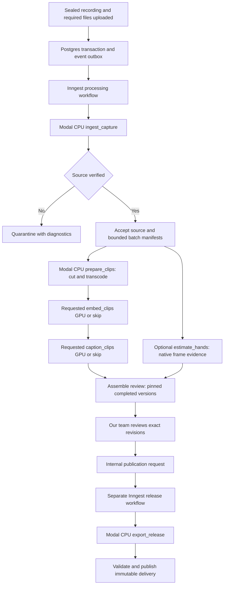

# Job orchestration and recovery

Status: proposed implementation. Updated: 2026-10-22. Decision owner: backend/platform engineering.

Parent: [Technical design](../technical-design.md). Canonical topology: [processing execution and data flow](pipeline-execution-and-data-flow.md). Contracts: [storage/schema](storage-and-data-model.md), [cloud processing](cloud-processing.md), [uploads](mcap-upload.md), [operations](operations-and-costs.md).

## Decision: Inngest + Postgres + Modal

Use **Inngest Cloud** to coordinate the application workflow, **Postgres** for application records and a transactional event outbox, and **Modal private Functions** for finite CPU/GPU execution. Curator's local Ray runtime schedules tasks only inside a Curator worker.

Inngest supplies durable steps, waits, retries and execution visibility. Our code defines dependencies and policy using those primitives. The application owns input integrity, artifact provenance, batch writer ownership, access control, cost admission, idempotency and acceptance/publication. Curator keeps its stable canonical dataset and native checkpoints across compatible attempts. There is no cross-service exactly-once transaction or per-stage full dataset copy.

Do not deploy `pgmq`, Redis, Airflow or a second DAG scheduler in v1. The initial queue-only proposal was evaluated and replaced because managing stage dependencies and restart behavior ourselves would add avoidable engineering work. This document specifies the final recommended target.

## Three different scheduling layers

| Layer | Tool | Scope |
| --- | --- | --- |
| Product workflow | Inngest | Upload seal, CPU ingest/preparation, bounded batch stage barriers, optional inference, review join and independent release export |
| Compute execution | Modal | Start/stop Python containers, provision CPU/GPU, enforce function deadlines and per-function concurrency |
| Curator internal execution | Ray Data / Curator recipes | Decode/inference/transcode tasks within one isolated Curator invocation |

An application DAG is a graph of dependent jobs. It is not a GPU cluster. Ray accelerates processing work but does not decide who may upload a recording, whether an internal reviewer approved labels, or which customer can download a release. Curator's own orchestration/runtime boundary is separate from the product workflow. [Curator Ray Data design](https://github.com/NVIDIA/cosmos-curator/blob/84f54d844bfc6fdf839848f6644f3fc893f52209/docs/curator/design/ray-data.md), [Curator non-goals](https://github.com/NVIDIA/cosmos-curator/blob/84f54d844bfc6fdf839848f6644f3fc893f52209/docs/curator/design/curator-next.md), [Curator Ray runtime](https://github.com/NVIDIA/cosmos-curator/blob/84f54d844bfc6fdf839848f6644f3fc893f52209/cosmos_curator/next/core/ray_runtime.py), [Curator pipeline entrypoint](https://github.com/NVIDIA/cosmos-curator/blob/84f54d844bfc6fdf839848f6644f3fc893f52209/cosmos_curator/pipelines/pipeline_runtime.py).

If “AirDAG” means Airflow DAGs: Airflow can coordinate the outer workflow and launch the same processing work through a qualified integration. Curator is video-processing code rather than a replacement for that scheduler. AWS also offers MWAA Serverless, billed by task duration with a one-minute minimum, so Airflow does not inherently require an always-on environment. Inngest is recommended for this event-triggered TypeScript product's integration and durable waits; the choice is not based on an assumed permanent Airflow service charge. [AWS MWAA pricing](https://aws.amazon.com/managed-workflows-for-apache-airflow/pricing/), [MWAA Serverless capabilities](https://docs.aws.amazon.com/mwaa/latest/mwaa-serverless-userguide/what-is-mwaa-serverless.html).

## Alternatives and why the choice is conditional

Prices/features were checked on 2026-10-22; verify again before activation. License statements describe inspected components, not a blanket legal conclusion about every dependency.

| Candidate | What we reuse | Pilot tradeoff | Decision |
| --- | --- | --- | --- |
| Inngest Cloud | Durable steps/waits/retries, UI and TypeScript Edge/Fastify adapters | External workflow service, execution quotas and signed inbound endpoint; SDK Apache-2.0, server SSPL/future Apache terms | Recommended managed candidate; qualify the selected Node or Edge runtime |
| Supabase Queues / pgmq | Logged Postgres queue, visibility timeout, archive | Queue is not a DAG engine; we would write dependency scheduling, workflow timers, failure handling and replay rules | No v1 deployment |
| Temporal Cloud | Durable workflows, timers/signals, strong operational tooling | Current pricing has no base fee; integration/runtime and worker design are more involved for our owned TypeScript API | Credible alternative if workflow needs justify it |
| Prefect | Python workflow API, processing-oriented UI | Current free Hobby has limited deployments/users; custom work pools/BYO compute require the relevant paid plan | Revisit if Python data operations dominate |
| Airflow, including MWAA Serverless | Mature DAG orchestration/backfills; managed pay-per-task option | YAML/Python/AWS integration and supported operators need qualification; no blanket always-on-cost objection | Credible alternative; TS event/product integration favors Inngest here |
| Dagster | Asset orchestration, lineage and backfills | Additional asset/control-plane model to integrate with product and Modal execution | Revisit if asset-centric data operations dominate |
| Modal alone | Async function execution and provider queue | Does not replace our workflow dependency state, app audit, review or dataset release semantics | Compute layer only |

Inngest currently lists a $0 plan with 50,000 executions/month and five concurrent steps; executions count runs and steps, so polling must be budgeted. Temporal currently lists no base monthly fee and starts at $50/million actions plus storage/support. Do not reject Temporal using an obsolete monthly minimum. Prefect lists free Hobby and $100/month Starter with BYO compute. [Inngest pricing](https://www.inngest.com/pricing), [Temporal pricing](https://temporal.io/pricing), [Prefect pricing](https://www.prefect.io/pricing), [Supabase Queues](https://supabase.com/docs/guides/queues).

## Workflow graph

Only enabled, required branches participate in the join. A disabled branch is recorded as not requested, not a successful annotation. A required branch failure blocks review readiness; optional failed proposals may be omitted only under an explicit profile, with limitations visible. Human review does not hold a running GPU or depend on retaining an Inngest workflow for weeks: publication starts a separate workflow from durable approved records.

Initial physical stages are `ingest_capture`, per-batch CPU `prepare_clips` (`video-cut` then `video-transcode`), requested GPU `embed_clips`, requested GPU `caption_clips`, optional `estimate_hands`, `assemble_review`, and independent postapproval `export_release`. Ingest streams the raw MCAP once per fresh invocation and builds bounded prepared video sources, native frame/sensor shards, mappings, compact QC and previews. Local parsing may reread scratch, and an unrecoverable ingest retry may redownload raw bytes.

Each bounded batch freezes its row set before downstream inference. `prepare_clips` completes its native transcode publication/readiness checks before embedding or captions start. Those stages use the same dataset URI/media root and add their owned fields. Hand computation writes per-frame external artifacts; its controlled catalog-reference update acquires the same batch writer ownership. Initially serialize all canonical batch mutations, even when disjoint native fields could theoretically run concurrently.

Native recipe commands do not automatically share a download cache. Cut probing may read/download prepared sources, transcode downloads a bounded source for its remaining grouped spans, and embedding/captioning fetch clips again. A shared container does not prove scratch reuse. Source byte/duration limits, bounded fragments and actual read/write accounting are defined in the [execution contract](pipeline-execution-and-data-flow.md).

## Application records and event contract

`processing_runs`, `processing_batches`, `stage_jobs`, `job_attempts`, `artifacts`, `resource_slots`, `budget_reservations` and `event_outbox` are authoritative application records. A processing batch owns stable dataset/media/checkpoint identity, frozen selection and row-set digests, observed/accepted commit versions, current writer and capability/termination evidence. Attempts identify invocation ownership, unique logs/receipts and spend; they do not allocate fresh canonical Lance roots. Inngest execution IDs and Modal call IDs are external references, not primary business identities.

Store the workflow graph in versioned Inngest code. Do not maintain a competing custom DAG scheduler or dynamically unlock successors through a second queue daemon. DB stage state supports audit, UI, deduplication and policy. The Inngest workflow determines which step to call next after validating predecessor state.

Events carry IDs and versions only. Proposed event names:

| Event | Producer transaction | Consumer |
| --- | --- | --- |
| `recording/ingest.requested` | Seal/upload gate creates one run, initial job and outbox event | Ingest/processing workflow |
| `processing/run.requested` | Authorized internal reprocess request creates a new immutable run | Processing workflow |
| `release/export.requested` | Internal admin freezes release selection and creates export job/outbox event | Release workflow |
| `processing/cancel.requested` | Internal cancellation changes app state and writes event | Cancellation handling plus independent reconciler |

Envelope: `event_id`, `schema_version`, `org_id`, `project_id`, `recording_id` or `release_id`, `run_id`, applicable `batch_id`, `pipeline_revision`, `requested_at`. Batch job descriptors add authorized dataset URI, expected upstream version/receipt, result-contract digest and source/selection-manifest reference. Version/selection fields support our preflight and provenance; they are not arbitrary native Curator YAML options. No video bytes, presigned URLs, worker tokens, model secrets or contributor PII. Load authoritative scope from Postgres; an event's `org_id` is not authorization.

The upload/seal transaction inserts `event_outbox` together with the domain change. A bounded outbox relay claims pending rows using short leases, submits to Inngest with a deterministic event ID, and marks delivered after acknowledgement. Host it as an owned Node companion or scheduled short Supabase Edge invocations, according to the selected control plane. Retry with bounded backoff, without holding a DB transaction during HTTP. Lost acknowledgement replays the same event ID; DB uniqueness/claim guards must reject duplicate logical workflows after provider deduplication expires.

This is an outbox, not another workflow queue. A restart scans undelivered records. Outbox delivery failure leaves a visible pending state and alert rather than losing a recording between upload and processing.

## Hosting the workflow handler

Hosting is provisional; qualify one of these owned TypeScript adapters without inheriting the cloned Bun/Hono server:

| Variant | Handler | Important configuration |
| --- | --- | --- |
| Supabase Edge / Deno | `inngest/edge` with `Deno.serve` | Set `servePath=/functions/v1/<function-name>` or `INNGEST_SERVE_PATH` to match Supabase's rewritten route |
| Owned Node.js 24 / Fastify | `serve` or plugin from `inngest/fastify` | Register the dedicated `/api/inngest` route, correct public origin and supported GET/POST/PUT behavior |

Pin the SDK version/major, preserve supported body/signature handling, set production signing keys and test registration. Official docs cover both adapters; that is not a successful deployment canary. [Inngest framework adapters](https://www.inngest.com/docs/learn/serving-inngest-functions).

The service route uses Inngest SDK signature verification, not human cookies or Supabase user JWTs. A platform JWT gate must not block legitimate signed service delivery; any bypass is restricted to this handler, whose SDK verification remains mandatory. Identity/session selection is a separate decision in [auth](auth-and-access.md).

Handlers submit/check work and return promptly. They never wait for inference or copy media. Use a bounded supervised Node relay/reconciler, or scheduled short Edge invocations with bounded DB connections and service authentication. Both variants require restart/overlap-safe claims. Neither executes MCAP/model work on the API runtime; its outage delays control flow while durable state remains in Postgres/object storage.

## Executing one Modal stage safely

Each durable step is short. Store large outputs in object storage and return IDs/summaries. The following is the required protocol; it is not implemented code.

1. **Admit.** Check lifecycle, source/selection/parent digests and applicable accepted dataset version, profile/model permission, quota and deadline. Lock job/batch/budget/resource rows. Create an attempt and increment `claim_epoch`, reserve estimated cost and GPU slot when required, and acquire exclusive batch mutation ownership. Before takeover, require previous provider execution terminal **and all outstanding write capabilities expired/revoked** with clock-skew margin. First ingest instead requires sealed required uploads; its CPU worker establishes server hashing. Commit before Modal submission.
2. **Submit.** Through Modal's private JS SDK, call the deployed Python Function with the attempt envelope. Persist `functionCallId` once returned. Persist a submission counter and initially permit exactly one spawn call per attempt. If acknowledgement is lost, mark dispatch_unknown and do not call spawn again automatically. Do not create a new attempt just because the HTTP acknowledgement was lost.
3. **Claim inside the worker.** Every invocation creates an invocation ID and calls a narrow service-authenticated endpoint. A compare-and-set accepts one owner for active `(attempt_id,claim_epoch,batch_id)` and current writer identity. It checks absolute start deadline and non-cancelled/non-deleted lifecycle. Losers exit before media/model downloads. The winner receives immutable configuration and short-lived capabilities for the authorized stable batch/native workspace, inputs and unique attempt receipts; never a published-release write grant. Resume compatible native state at that same root rather than copy it.
4. **Wait durably.** Inngest sleeps, then a short step checks provider/app status. Start with a 30-second poll interval, increasing to two minutes for longer stages. Use stable, unique step IDs per poll and a bounded stage deadline. Enforce a total run step budget below the documented 1,000-step limit, step results below 4MiB, total persisted state below 32MiB, and Free run lifetime below 30 days. Initial policy: at most 400 control/sleep/poll steps per recording workflow; a larger fan-out becomes a separately budgeted child workflow. Never hold an HTTP request, CPU container or DB connection open waiting for a GPU.
5. **Verify canonical publication and accept.** Native processing first makes payload/results/checkpoints durable, then commits and verifies owned Lance columns/receipt. A permanent attempt result records actual dataset/version/contract/selection and row outcomes. Validate scope, immutable payload hashes/bytes, canonical publication evidence and reference closure; bounded heavy validation runs on cloud CPU, not inside a long HTTP request. A short compare-and-set checks current attempt/claim/invocation/batch owner, expected inputs/observed publication, and active lifecycle, then atomically accepts that pinned dataset version/artifact set and marks success. No full dataset copy occurs between stages. A cancelled/deleted job may leave a physical commit but cannot win application acceptance.
6. **Settle and transfer ownership.** Reconcile usage and reservations; release compute slots only after provider execution is terminal. Retire all of that writer's storage grants before releasing/regranting canonical batch ownership. Successors require both accepted predecessor state and safe ownership transfer. Compatible native recovery reconciles committed/checkpointed work; it must not repeat inference simply because the callback was lost.

The Modal TypeScript SDK documents Node.js 22+, Deno and Bun support; Node 24 and Supabase Edge are distinct qualification targets here. Its private call shape is `modal.functions.fromName(...)`, `worker.spawn([job])`, and `call.functionCallId`. Pin/test imports, secrets, networking, deadline behavior and actual timeout classes in the chosen environment. A polling timeout is not remote failure; finite provider result retention does not replace durable receipts. [Modal JS SDK](https://modal.com/docs/sdk/js/latest/intro), [FunctionCall API](https://modal.com/docs/sdk/js/latest/FunctionCall), [invocation methods](https://modal.com/docs/guide/function-invocation-methods).

Worker capability fields: hashed random token, run/batch/attempt IDs, claim epoch, allowed actions/paths, expiry and invocation owner. Track every issued object-write capability's expiry/revocation evidence. Tokens travel through private invocation/service headers, never events/manifests. Refresh only for the active owner/deadline. A DB token rotation alone does not revoke signed object requests. Workers have no general DB or human-session credentials; batch-wide write grants are not field-level ACLs. Qualify the pinned adapter's immutable-input/owned-field behavior and provider scope explicitly.

Final release export is separate: a bounded trusted CPU task reads frozen approved versions and labels, materializes/copies only the payloads required for portable delivery or isolation into a unique protected release root, and validates closure/checksums. A short publication transaction rechecks frozen selection, authority/rights and lifecycle. Native processing workers cannot mutate published delivery objects.

## Stable canonical batch and native checkpoint contract

One bounded `processing_batch` has one stable `media_root` and Lance URI, normally containing `lance`, `clips` and native recipe staging trees. Keep these identities across compatible stage attempts; only logs, diagnostics, invocation identity and application receipts use fresh attempt directories. Postgres stores observed/accepted versions and receipts, not a copied replacement table at every handoff.

Initially one external logical writer owns the batch. Native helpers do not supply that lease. Transcode/embed shared recovery freezes a selected fragment/file layout, stages validated Parquet plus checkpointed IDs, atomically publishes its owned fields, verifies a receipt, then cleans eligible workspace state. Caption has recipe-specific recovery; cut is a producer with its own recovery path. Preserve each native layout and required transaction history. API lifecycle acceptance remains separate from a native physical commit.

Keep prepared/clip inputs, row identities, input columns and physical fragment layouts immutable. Prohibit compaction, row deletion, data-file rewrite and vacuum/history pruning while recovery or pinned consumers depend on them. Resume a saved compatible selection before new work. The initial frozen bounded batch avoids assuming arbitrary selection or a growing-table-ready-subset API in stock recipes. Wrapper version/selection descriptors are preflight/provenance, not invented YAML fields.

Before same-root takeover, verify old execution termination and expiry/revocation of every outstanding write capability, with clock-skew margin. If either is uncertain, pause the batch; do not create a competing retry against that root. Deliberately starting a separate new run/root is an explicit recovery operation with its own budget, not silent checkpoint reuse. Do not purge native recoverable state under an attempt-log retention rule. [Native checkpoint and concurrency contract](https://github.com/NVIDIA/cosmos-curator/blob/84f54d844bfc6fdf839848f6644f3fc893f52209/docs/curator/design/curator-next-checkpoint-recovery.md).

## Retry and concurrency policy

The application permits execution at least once and accepts one fenced result. Duplicate submission can still incur container startup cost; the claim protocol prevents duplicate model work and conflicting accepted results. Do not describe this as exactly-once GPU billing.

| Failure | Required action |
| --- | --- |
| Outbox delivery acknowledgement lost | Replay same event ID; duplicate workflow guard returns existing run |
| Modal submit acknowledgement lost | Mark `dispatch_unknown`; wait for worker claim/result, reconcile provider state; never blindly create another attempt |
| Duplicate invocation of same attempt | One worker claim wins; others exit before expensive work |
| Temporary input download error | Bounded native retry or compatible new attempt at the same root after termination and write-capability retirement |
| OOM / unsupported image / invalid model license | Terminal configuration failure; no automatic larger-GPU escalation or repeated spend |
| Corrupt MCAP / mismatched SHA / unsupported schema | Quarantine; no GPU successors |
| Lease expires while provider may still execute | Block compute replacement and root takeover; reject late claims after start deadline, but also require provider termination and all write-capability expiry/revocation before reuse |
| Worker dies before manifest | Retain canonical checkpoint/results/history; reconcile physical publication and recover compatible pending work after safe takeover |
| Worker succeeds but callback/DB fails | Validate native receipt/canonical version and permanent result; accept idempotently without repeating completed inference |
| Source/config contract or fragment layout incompatible | Fail and retain evidence; new run/dataset or versioned result field contract, not blind in-place reset |
| Inngest step retries after accepted success | Return existing accepted job/artifact IDs; do not launch another model |
| Authorized assigned internal staff requests cancel | Stop successors, cancel known provider call best effort, fence claims/results; keep billed usage reserved until reconciled |
| Workflow quota/outage | Retain outbox/application state; pause new starts; reconcile active jobs independently |

Initially configure Modal retries to zero and let explicit stage policy control attempts. Inngest control-step retries must not automatically create new GPU attempts. Proposed stage execution limit: one initial attempt plus at most one operator-authorized retry for a diagnosed transient issue during qualification. Increase automation only after fault tests show safe handling.

Use Inngest concurrency to smooth control work, plus DB compute slots and independent batch-writer ownership. Modal `max_containers=1` is per Function, so separate GPU Functions otherwise run concurrently. Initially zero warm/buffer containers, one globally admitted GPU attempt and at most two CPU attempts. A confirmed-terminal GPU can release its compute slot while the batch remains blocked awaiting write-capability expiry; those are different resources. Never release/regrant the canonical writer merely because a durable step stopped waiting. Human review and unrelated packaging hold no GPU slot.

## State and reconciliation

Use canonical enums in [storage/schema](storage-and-data-model.md). `dispatch_unknown` differs from `failed`. Native stage success requires verified canonical publication and a successful application acceptance CAS; immutable non-Curator artifacts require validated identity/hash. Internal review approval and release publication are separate records. Workflow expiry does not delete accepted data or invalidate releases.

When a submission has no retrievable call ID, reconciliation cannot infer a safe zero-cost outcome from silence. Revoke its startup capability atomically at the absolute start deadline so late invocations cannot begin heavy work. Keep its submission/accounting uncertainty visible; operator/provider investigation or a deliberately budgeted fenced replacement is required. Late startup can still be billed.

A proposed 60-second reconciliation schedule, bounded by rate/host limits, checks undelivered events, uncertain submissions, stale compute/batch leases, outstanding write grants, native publication receipts/versions without app acceptance, terminal calls without receipts, and stuck release exports. Node may use a supervised loop; Edge uses scheduled short invocations with persisted cursor/claims rather than an infinite process. Repair by deterministic IDs or escalate ambiguity; never implement a second DAG scheduler. Alert on outbox age and unreleasable resource/writer ownership.

A workflow deployment pins `pipeline_revision`. Keep compatible old definitions/workers until active runs finish, or intentionally pause/reprocess. Durable step names are persisted contracts; do not rename/reorder active steps without versioning. Retries preserve source, row-set, model and result-contract identity. Explicitly approved execution tuning can vary only where native compatibility permits, with effective configuration/cost recorded per attempt. Source/model/meaning changes require a deliberate new run/dataset or versioned field contract.

## Cost controls and license boundary

Estimate workflow executions as well as GPU hours. A polling design with multiple steps per poll can consume a free quota even when the GPU stage itself is short. Measure actual counted executions in qualification. Prefer completion events plus a reconciliation timeout later if polling becomes material; completion events must come from an authenticated service relay and remain idempotent.

Use the Apache-2.0 Inngest JavaScript SDK with managed Inngest Cloud under its service terms. The current Inngest server/CLI license is SSPL with a future Apache grant; do not label that whole server Apache or ship a hosted fork without review. [SDK license](https://github.com/inngest/inngest-js/blob/main/packages/inngest/LICENSE.md), [server license](https://github.com/inngest/inngest/blob/main/LICENSE.md). No self-hosted server is part of this plan.

`pgmq` remains a useful transport if we later choose a custom controller: `send` can share a domain transaction; `read` hides a message for a visibility window; `archive` acknowledges it. The window does not guarantee exactly-once processing, and a successor stage is enqueued only after validated predecessor success. These facts explain how a queue can support a DAG, but do not remove the controller implementation we are avoiding. [pgmq API](https://supabase.com/docs/guides/queues/pgmq).

## Implementation and acceptance

Proposed Node variant: workflow registry/Fastify route in owned `backend/src/workflows/`, admission/batch ownership/acceptance services in `backend/src/services/processing/`, relay/reconciliation in `backend/src/workers/` and migrations in `backend/src/db/`. The Edge variant places equivalent owned signed handlers and scheduled bounded services under `supabase/functions/`, sharing versioned contracts and reviewed database access. These are alternative hosting targets. Both call Python Functions in root `processing/modal_app.py`; processing stages/contracts remain in `processing/` independently of API hosting.

Required fault tests:

- Crash at each DB/HTTP boundary, including after remote spawn and before saving its call ID.
- Deliver the same outbox event repeatedly and invoke the same attempt concurrently; one logical result is accepted.
- Stop a worker after outputs but before its receipt; restart the API and recover without rerunning accepted inference.
- Expire a lease while a fake provider call remains running; no replacement GPU work is admitted.
- End provider execution while an issued write grant remains valid; the next stage cannot obtain the same canonical root until retirement/expiry evidence passes.
- Recover the same batch URI after durable checkpoint and after ambiguous Lance commit; skip checkpointed work and reconcile native receipts without per-stage full copies.
- Attempt fragment compaction/deletion or source rewrite; recovery fails rather than accepting incompatible evidence.
- Reject stale claim epochs, foreign prefixes, oversized manifests and mutated output hashes.
- Exercise required/optional branch joins, quota exhaustion, cancellation and pipeline-version rollout.
- Prove human review survives workflow retention expiry and starts a separate release workflow.
- Pause canonical acceptance before final CAS, win cancellation/deletion in another transaction, and prove no success pointer is selected despite a physical native commit.
- Verify exact Edge `servePath`, signature/JWT perimeter and Modal Deno import/network behavior, or the corresponding Node/Fastify origin/body/signature adapter.
- Validate final release closure/checksums and immutable destination separately from native stage acceptance.
- Record counted Inngest executions, provider seconds and actual cost for a representative complete run.

Do local tests with a fake Modal adapter and an isolated test database. A real cloud smoke test is a later bounded deployment action; this document does not run one.
