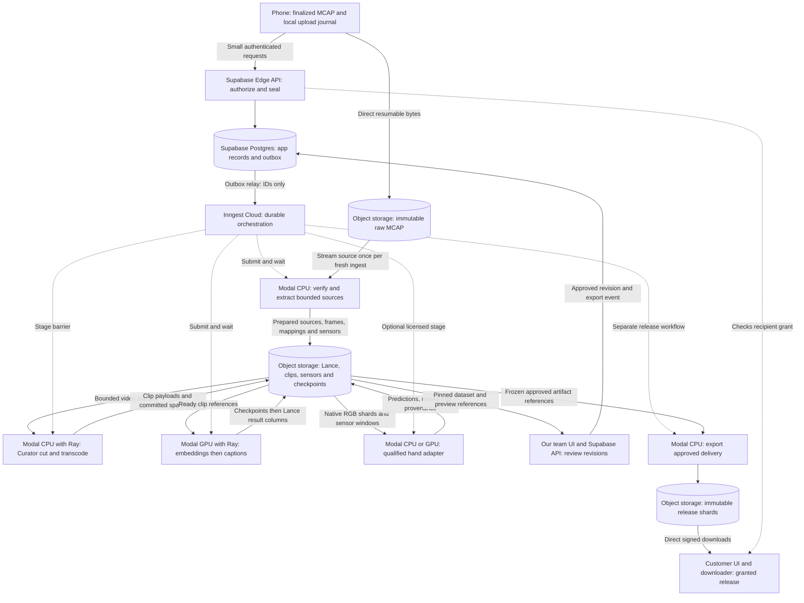

# Processing execution and data flow

Status: proposed architecture, 2026-10-22. No cloud deployment or long-recording qualification has occurred.

This is the canonical processing topology for the [technical design](../technical-design.md). It adopts Curator's durable dataset/checkpoint pattern and supersedes earlier suggestions to copy a fresh Lance dataset into every attempt. Model adapters, platform limits and licenses still require qualification.

## 1. The pattern we adopt

Use Ray Data for processing inside a Modal worker, Lance for the canonical clip/span table, object storage for bulk media/sensor payloads, and durable result/checkpoint files for recovery. Inngest coordinates the application-level jobs; Supabase Postgres holds users, grants, recording/run state, outbox and review/release records.

Curator's pinned Next design explicitly separates Ray Data execution, Lance datasets, payload references and user-authored policy. These are architectural patterns to reuse, rather than an obligation to build a new framework or use every model. [Curator boundary](https://github.com/NVIDIA/cosmos-curator/blob/84f54d844bfc6fdf839848f6644f3fc893f52209/docs/curator/design/curator-next.md), [Ray Data design](https://github.com/NVIDIA/cosmos-curator/blob/84f54d844bfc6fdf839848f6644f3fc893f52209/docs/curator/design/ray-data.md).

The concrete topology below uses the Supabase-hosted API option: TypeScript Edge Functions on Deno. The separately discussed Node.js/TypeScript service can implement the same control contracts on its own host. Choosing Edge Functions is a runtime/hosting decision, not a requirement of the processing design. The API/auth choice remains a decision before implementation; old Stera server code is only protocol evidence.

## 2. Where each responsibility runs

| Responsibility | Location | Holds durable data? |
| --- | --- | --- |
| Capture and resumable transfer | Repair worker's Flutter app | Local original/journal until verified remote ingest and explicit local retention policy |
| Login/access, recording registration, upload authorization, review/delivery APIs | Supabase Edge Functions in this topology | Small requests only; state in Postgres |
| App catalog and workflow records | Supabase Postgres | Users/grants, uploads, run/batch/job IDs, accepted dataset versions, reviews/releases/outbox |
| Workflow progression and durable waits | Inngest Cloud | Small control state; no media or model arrays |
| MCAP ingest and video preparation | Modal CPU Function | Scratch is temporary; committed outputs/checkpoints in object storage |
| Embedding/caption inference | Modal GPU Functions with local Ray | Model cache in Modal Volume; dataset/results in object storage |
| Hand estimation and robotics QC | Separate qualified Modal CPU/GPU adapter | Native-frame observations and masks in object storage |
| Canonical clip/span datasets | Lance over the qualified object-store backend | Versioned rows/columns and transaction history |
| Raw/media/sensor/checkpoint/release files | Private object storage; R2 is the current cost candidate | Canonical bulk data; S3 or Supabase Storage requires equivalent contract tests |
| Review and customer UI | Static browser application calling authorized APIs | No independent source of truth |

R2 compatibility is not established by the S3 URI scheme alone. Qualify Lance conditional commits, Arrow/Botocore session tokens, listing and recovery before adopting it. A failed qualification changes the object-store provider; it does not require rebuilding the processing graph.

## 3. Annotated pipeline

Solid arrows identify data/control transfers; dotted arrows identify orchestration/authorization. Inngest invokes short handler steps on our API; those steps asynchronously submit Modal work and return. No Supabase request waits for inference to finish.

### Stage contract

| Stage | Runs on | Reads | Writes | What the next stage receives |
| --- | --- | --- | --- | --- |
| 0. Register, authorize and seal | Supabase Edge API + Postgres | Identity, assignment, declared file inventory/size/hash | Recording/file/upload rows, frozen logical inventory | Server-owned IDs and upload capabilities |
| 1. Upload raw files | Phone directly to object storage | Finalized local MCAP and required sidecars | Original objects; uploaded-part receipts | Completed object references; a transaction creates the ingest request/outbox event once all required files arrive |
| 2. Verify and extract | Modal CPU `ingest_capture` | Raw MCAP stream and sidecars; one download per fresh ingest, then local parsing | Server SHA-256, channel/geometry QC, bounded RGB source segments, native frame shards, sensor/calibration files, source-time mappings and ingest manifest | Manifest artifact ID/hash plus prepared-source references and bounded batch membership |
| 3. Plan clip spans | Modal CPU + local Ray, Curator `video-cut` | Prepared-source URIs and probed metadata | Canonical Lance span rows with stable native IDs and source/time references | Same dataset/media root and committed table state |
| 4. Materialize clips | Modal CPU + local Ray, Curator `video-transcode` | Pending span rows; each required prepared source grouped once per processing pass | Standalone MP4 clips, Parquet result/checkpoint files, clip columns and native transcode publication receipt | Same dataset URI, ready clip rows and recorded commit/version |
| 5. Embeddings, when requested | Modal GPU + local Ray, Curator `video-embed` | Ready clip URIs and pending embedding fields | Batch result checkpoints, embedding/status fields and canonical commit | Same dataset with completed embedding fields; errors explicit |
| 6. Captions, when requested | Modal GPU + local Ray, Curator `video-caption` | Ready clips and caption recipe inputs | Caption result files, recipe-specific recovery state and published caption fields | Same dataset with caption outcome/provenance fields |
| 7. Hand estimates, when requested | Qualified Modal CPU/GPU adapter | Native RGB frame shards and exact calibration/depth/pose windows | Per-frame raw predictions, validity masks, transforms, compact QC and immutable external-array references | Artifact manifest; controlled adapter adds references/summary fields to the clip catalog |
| 8. Assemble review | Modal CPU + short API acceptance | Pinned completed dataset, QC, preview/mapping and enabled branch results | Review-package manifest; Postgres review-ready reference | Our team's UI loads exact versions and signed artifact references |
| 9. Review and correct | Our team's browser + Supabase API | Review package and exact label revision | New immutable annotation revisions and append-only review decisions | Approved revision/profile IDs; no video forwarding through the API |
| 10. Export delivery | Modal CPU, separate Inngest release workflow | Frozen approved dataset/artifact/label/rights selection | Portable shards, loader/schema, checksums, dataset card and complete release manifest | Published release ID and immutable object inventory |
| 11. Inspect/download delivery | Customer browser/downloader + API | Granted published release manifest | Local verified download; server audit of grants/capability issuance | Complete trainable package defined by that release, never a customer episode-approval queue |

Stages 2–4 are logical operations. They may share a CPU worker where the adapter can actually reuse scratch files and durable input identities. Merely invoking independent stock recipe commands in one container does not make their download implementations share a cache. Initial deployment should measure those reads rather than assume fusion eliminates them.

Embedding and captions can share one GPU invocation if environment/model fit, unload behavior and measured cost support that choice. Otherwise use separate workers and acknowledge repeated clip reads. Different images/GPU types or expensive retry boundaries justify separation. Keep initial global GPU admission at one active job; model stages remain opt-in rather than mandatory costs.

## 4. Two-hour recordings and bounded processing

Preserve one logical recording even when processing it in many bounded units. Ingest streams the MCAP to scratch while hashing, then extracts/indexes without retaining all decoded frames or depth images in RAM. Writing a source index/sensor shard progressively is required; current short-recording helpers are not established as memory-safe two-hour production processors.

Create independently decodable RGB sources with **both byte and duration limits**. A proposed first target is one to five minutes and a tested byte ceiling; reduce duration instead of silently reducing required pixel quality when the byte ceiling would be exceeded. Set the actual byte ceiling from a worker-memory qualification. Bound rows/fragments and outstanding source downloads as well as file size.

Preserve original JPEG/native pixel evidence and exact frame mappings separately for geometry. A compressed presentation/proxy variant is not automatically an acceptable input for metric hand estimation. Avoid millions of tiny per-frame objects by storing indexed, bounded frame/sensor shards where suitable.

This preprocessing is necessary because the inspected native transcode path reads a whole prepared source into bytes, moves it through Ray's object store, writes a temporary MP4 and transcodes bounded clip batches. Backpressure is useful but not a hard bound on individual source size or serialization copies. [Native transcode data path](https://github.com/NVIDIA/cosmos-curator/blob/84f54d844bfc6fdf839848f6644f3fc893f52209/docs/curator/design/curator-next-video-transcode.md).

Use one canonical Lance table per **bounded processing batch**, not one giant mutable table for the whole company. A recording can have multiple batches; the application catalog links all of them. Freeze each batch's row set before downstream inference in v1. The inspected embed/caption recipes do not offer a general arbitrary-selection or growing-table-ready-subset interface. Finish the required transcode publication before starting them.

## 5. How intermediate state is passed

The handoff is a small descriptor: run/batch/job IDs, dataset URI, expected upstream commit/version, result-contract/config digest and source/selection-manifest reference. A worker reads data directly from the authorized object store. Signed credentials are issued at runtime and do not become permanent dataset fields.

Version/selection values in our descriptor support preflight and provenance. They are **not invented Curator YAML options**. Native recipes open/validate their own snapshot and may register schema before pinning it; our exclusive wrapper verifies readiness and records the actual snapshot/receipt used.

| Kind of state | Authoritative location | Next-stage behavior |
| --- | --- | --- |
| Bulk video/depth/frame arrays | Object storage | Fetch only needed source/clip/shard; no proxy through Supabase/Inngest |
| Clip/span identities, media references and enrichment fields | Lance | Open validated dataset state; read required columns and pending work |
| Expensive work not yet canonically published | Durable native checkpoint/result workspace | Recover compatible saved selection; skip durably checkpointed IDs |
| Application progress, ownership, budget, review and release | Supabase Postgres | API/workflow loads IDs and authoritative grants/state |
| Temporary execution batches | Ray object store inside the worker | Adjacent transforms can stream/fuse; not durable across containers |
| Reusable model weights | Modal Volume | Reload pinned cache; no repeated GPU-side weight download |

For the native recipes, the stable media root contains the Lance table, clip media and recipe staging trees. Transcode/embed shared checkpointing separates durable Parquet results from the canonical Lance commit. Caption currently has recipe-specific recovery, so preserve its own layout rather than force it into the shared contract. Successful cleanup can remove staging; our permanent application result receipt must remain.

## 6. Canonical data versus attempts

Preserve **the same dataset URI, media root, native contract namespace and compatible checkpoint workspace across retries**. Attempt IDs identify invocation ownership/logs/accounting, not a replacement dataset. Replacing the root on each retry loses native checkpoint identity and often causes duplicate downloads/inference.

Use a new dataset/run for changed source content or incompatible result contracts. Store model/config/decoder/image versions explicitly; version the output field contract when its meaning changes. Native schema registration must remain compatible with previously published fields.

Only one logical writer owns a batch's canonical mutation at a time initially. Ray may parallelize its internal tasks. Compatible native enrichments have field-level concurrency support, but introducing it is a later qualified optimization. Curator helpers do not provide writer leases.

Before regranting the stable root after a timeout or uncertain submission, confirm the previous writer has terminated and its write capabilities have expired/revoked. A DB `claim_epoch` alone cannot stop a stale container writing to object storage. If termination cannot be established, pause the batch or create a deliberately separate new run; never let competing retries mutate the same root.

Keep source media, input columns and physical fragment layouts immutable. No compaction, row deletion, vacuum/history pruning or data-file rewrite during the batch's recovery lifetime. Retain transaction history/receipts required by consumers. Do not claim unrestricted Lance maintenance is compatible with the pinned Curator publisher.

Payloads are durable before their IDs/results are checkpointed. Canonical success follows validated publication and commit reconciliation; process exit zero alone does not prove that every row has a successful media result. [Shared recovery contract](https://github.com/NVIDIA/cosmos-curator/blob/84f54d844bfc6fdf839848f6644f3fc893f52209/docs/curator/design/curator-next-checkpoint-recovery.md).

Do not copy the entire dataset at every stage. Snapshot the completed versions for review and freeze selected revisions at publication. If access isolation or a portable release requires a payload copy, perform it once in a bounded cloud export/promotion operation with a unique destination and verified closure/checksums. A worker never has write access to published release roots.

## 7. What is actually reread

| Boundary | Actual reads |
| --- | --- |
| Raw MCAP to ingest | One network stream per fresh ingest; local parser passes may reread scratch. A lost ingest with no reusable checkpoint may need another stream. |
| Ingest to Curator cut | Prepared sources are probed; the selected probe/splitting mode may read ranges or download the source. It does not need raw depth/IMU MCAP. |
| Cut to transcode | Native recipe groups pending spans by source and fetches that bounded source for remaining work. Partial recovery may fetch it again. |
| Transcode to embedding | Embedding fetches ready clip bytes. It does not reuse an earlier container's decoded-frame memory automatically. |
| Embedding to caption | Caption may fetch/decode clips again. Reusing a worker alone does not establish shared download/decode. |
| Hand inference | Reads native raster/sensor evidence needed by that model, which can differ from the caption proxy. |
| Review/QC | Mostly metadata, annotations and selected preview ranges. |
| Release packaging | Reads the approved payloads required for the delivery; it need not reread raw MCAP unless raw is included. |

The goal is bounded, reusable reads and selective recomputation, not an unsupported promise of zero repeated I/O. Measure bytes read/written per stage and cost per approved recording hour alongside inference throughput.

## 8. Required adapter work and qualification

Reuse native cut/transcode/embed/caption implementations and their existing recovery where compatible. Our additions are MCAP ingestion, robotics timestamp/geometry adapters, application auth/grants/outbox, job ownership and budget admission, hand-model adapter, review UI and delivery/export policy.

Hand pose is not supplied by these video recipes. WiLoR/MANO and FLORA remain subject to the documented commercial-use restrictions; a model is not enabled in commercial delivery merely because its wrapper runs on a GPU. Geometry validity and rights are independent release gates.

Pin the inspected source revision `84f54d844bfc6fdf839848f6644f3fc893f52209`. Next is an incubation namespace and the inspected transcode note says its full managed scale/worker-loss benchmark has not yet run. Reuse its design and tested building blocks, but qualify our exact source/image/storage/Modal deployment rather than inherit a scale claim.

First acceptance tests: representative two-hour MCAP ingest with bounded peak RSS/scratch; actual read-byte accounting; upload interruption and expiry; process/worker loss before and after checkpoint/commit; confirmed single-writer takeover; complete batch barriers; model/context memory fit; pinned dataset review and full release download. No paid test was run during this design.
