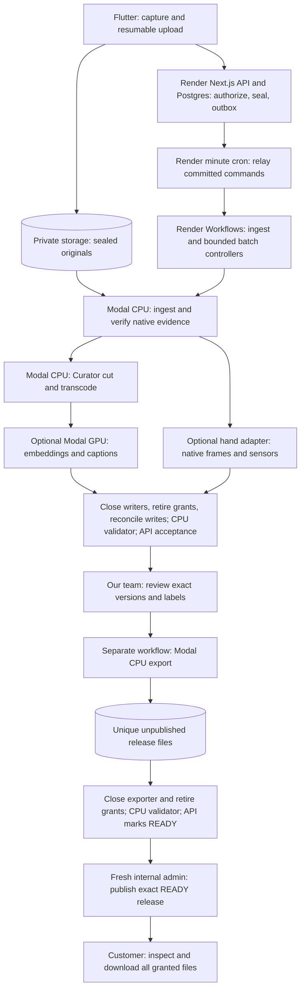

# Processing execution and data flow

Updated: 2026-10-26. Status: Render application stack selected; cloud and long-recording qualification remain open.

This is the canonical stage and data-handoff contract. Implementation details live in [cloud processing](cloud-processing.md), control/recovery rules in [orchestration](job-orchestration.md), and cross-language schemas in [contracts](../contracts.md).

## Build target and v1 product

Next.js/Node API, Better Auth, Render Postgres and Render Workflows are selected. R2 holds private payloads and private Modal workers execute all processing. [Render deployment](render-deployment.md) owns service/network placement; the stage contracts below own reads, writes and handoffs. The Stera server is protocol evidence, not a production dependency.

V1 delivers verified RGB recordings, exact source-frame mappings, compact QC, internal review and versioned customer downloads. Preserve available depth, IMU, calibration and camera tracking as separate evidence. Metric hand pose, robot actions and synchronized sensor supervision are not implicit RGB deliverables. GPU stages are opt-in and require model rights and qualification.

## Where work and bytes move

Arrows show workflow dependencies; media and intermediate files stay in R2. Every stage uses the write-barrier/validator/API-acceptance protocol before its successors; the diagram shows it once for readability. Disabled optional stages are explicitly skipped. Render controllers resume from Postgres/Curator state and submit/poll private Modal calls. Workers fetch objects directly. Publication selects validated files without another bulk copy; customers see only granted published releases.

## Canonical stage contracts

| Stage | Reads | Independently materialized output | Runtime and dependency |
| --- | --- | --- | --- |
| `ingest_capture` | Sealed uploaded MCAP and required sidecars | Server SHA-256, ingest manifest, bounded RGB sources, indexed native frame/sensor shards, calibration, frame/PTS mappings, compact QC and preview | CPU; source verification happens here |
| `prepare_clips` | One bounded batch's prepared-source manifest | Native `video-cut` Lance span rows; `video-transcode` MP4 clips, result Parquet/checkpoints, clip fields and publication receipt | CPU/local Ray; ingest accepted first |
| `embed_clips` | Ready clips and pending owned fields in the same batch table | Embeddings/status fields, checkpoints and canonical commit | Optional GPU/local Ray; complete transcode readiness first |
| `caption_clips` | Ready clips and required transcode provenance | Caption/provenance fields and recipe-specific recovery state | Optional GPU/local Ray; follows requested embedding stage |
| `estimate_hands` | Native RGB shards and exact calibration/depth/pose windows | Per-frame predictions, masks, transforms and immutable external-array references | Optional qualified CPU/GPU; controlled catalog update obeys batch ownership |
| `assemble_review` | All enabled accepted results and pinned batch versions | Review manifest referencing preview, mappings, QC and exact label revisions | CPU; our team alone reviews/corrects/approves |
| `export_release` | Frozen approved versions, labels and rights policy | Portable shards, loader/schema, checksums, limitations and release manifest | CPU workflow ends at validated `ready`; fresh admin session publishes separately |
| `validate_stage` helper | Quiescent candidate, authoritative inputs and barrier evidence | Small validation receipt binding candidate/version and barrier/grant generation | Separate trusted read-only CPU call; API alone accepts by final CAS |

Each result names source, run, batch, job, attempt, image/config/model contracts and actual dataset version. Handoffs contain the manifest ID/hash, dataset URI, expected upstream version, result-contract digest and selection-manifest reference. These are application preflight/provenance fields, not invented Curator YAML options. Native recipes pin their own validated snapshot, possibly after schema registration.

## Bounded recordings and stable datasets

One logical recording may contain many bounded processing batches. Ingest streams raw bytes to scratch while hashing, then parses progressively; native frame/depth arrays must not accumulate for two hours in RAM. Upload size limits do not prove scratch or processing capacity. Admission requires measured byte, duration, fragment, scratch and integer `max_batches_per_run` limits; exceeding them blocks processing explicitly.

Prepare independently decodable RGB sources, initially targeting one to five minutes plus a mandatory tested byte ceiling. Retain native encoded frames separately for geometry. Bound physical Lance fragment rows and outstanding source downloads. Native transcode holds whole source bytes through Ray and stages a temporary MP4; output clip duration alone does not bound RAM.

Keep one stable `media_root`/Lance table per batch, containing `lance`, `clips` and native staging trees. Compatible attempts reuse that root and checkpoint identity; fresh attempt directories hold logs/receipts only. Freeze row membership before inference. Existing input media, fragment layouts and referenced history remain immutable: no compaction, deletion, rewrite or vacuum while recovery or pinned consumers depend on them.

Only one external writer mutates a batch at a time. Before validation, prove the worker ended, disable renewals, retire **every write capability**, and reconcile outstanding writes/object visibility. Hold ownership through read-only validation and API acceptance; the receipt/CAS binds the unchanged barrier/grant generation, candidate and version. Only then transfer ownership. A DB epoch cannot stop storage writes. Do not copy the dataset between stages. Release exporters undergo the same quiescence barrier before validation/publication into their protection/portability boundary.

## Actual rereads

Raw MCAP needs one network stream per fresh ingest; local parser passes may reread scratch, and failed ingest may restart the stream. Cut probing may read/download prepared sources. Transcode groups remaining spans by source, downloads that bounded source for the pass, and may redownload unfinished sources on retry. Embedding and captions fetch clips again; sharing a container does not establish a cache. Hand inference reads native shards, not automatically the caption proxy.

Track actual bytes and selective recomputation. A reusable dataset/checkpoint pattern does not promise zero repeated I/O. See the pinned [Curator recovery contract](https://github.com/NVIDIA/cosmos-curator/blob/84f54d844bfc6fdf839848f6644f3fc893f52209/docs/curator/design/curator-next-checkpoint-recovery.md) and [transcode data path](https://github.com/NVIDIA/cosmos-curator/blob/84f54d844bfc6fdf839848f6644f3fc893f52209/cosmos_curator/next/recipes/video_transcode/processing.py).
