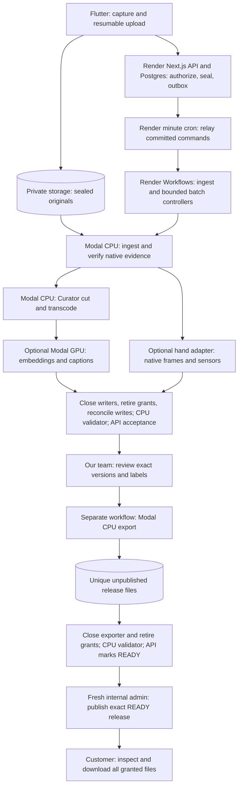

# Processing stages

Selected Render orchestration and Modal processing. Arrows show dependencies; canonical files stay in private object storage. Each producer stage requires writer retirement, independent validation and API acceptance before successors.

[Rendered PNG](processing-stages.png) is available when the Markdown viewer cannot render Mermaid.

