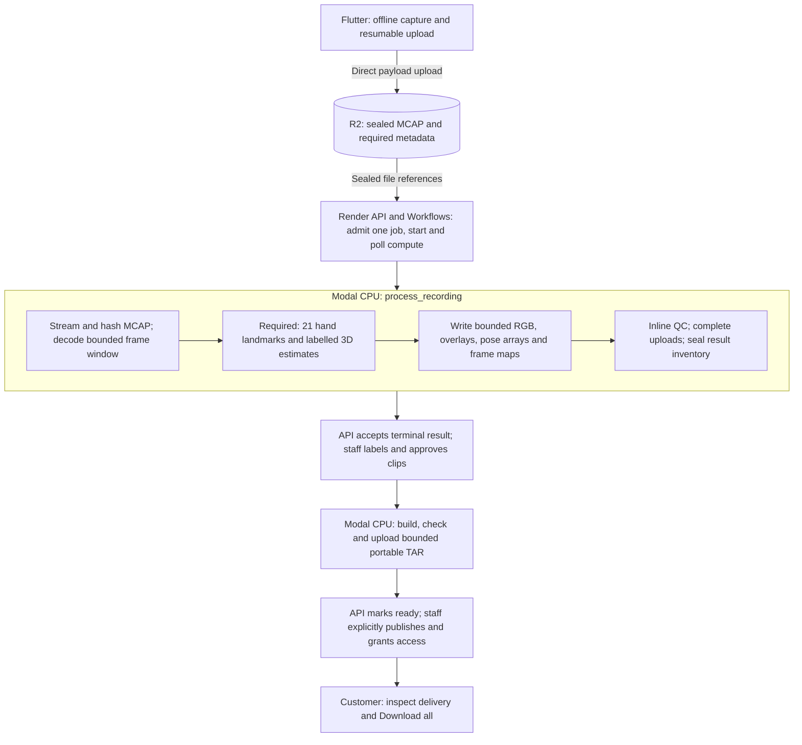

# Fixed MVP processing stages

Updated: 2026-10-30. Extraction, hand inference, preview and inline checks share one processing invocation. Export starts after staff approval and rereads selected completed files, without rerunning inference.

Local: the official Render Workflows runner starts the same Node tasks; LocalExecutor runs the same Python core, with local Postgres and MinIO. CPU is the default; a separately qualified local GPU profile is optional.
