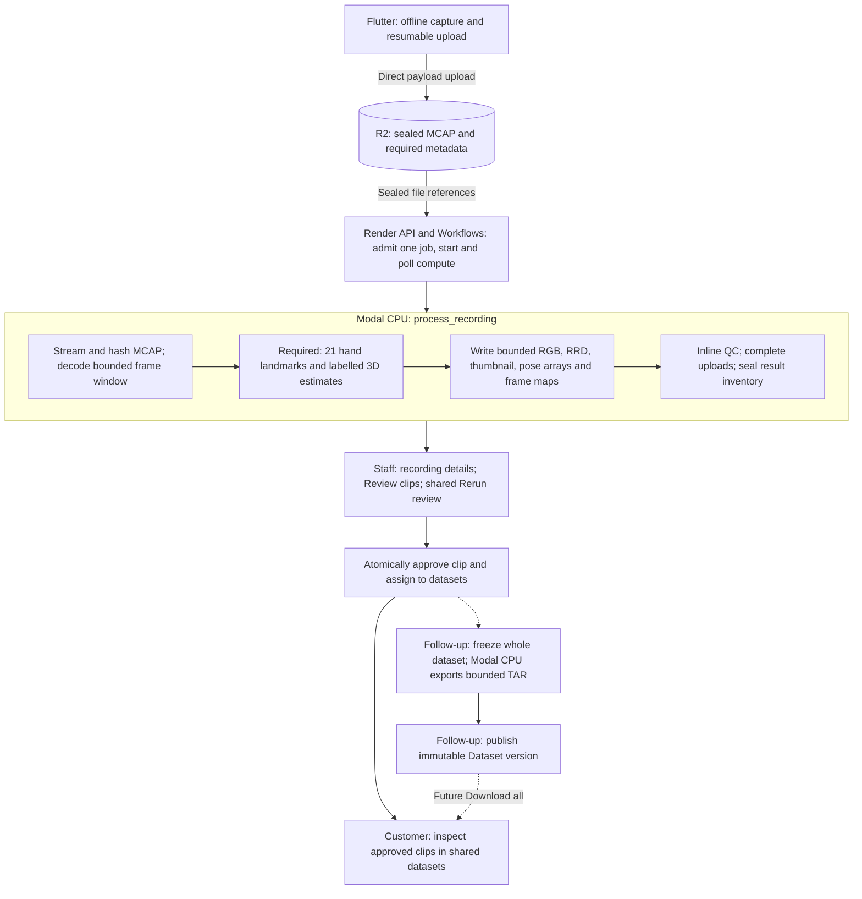

# Fixed MVP processing stages

Updated: 2026-10-31. Extraction, hand inference, preview and inline checks share one processing invocation. Staff enter review from Pipeline recording details or All clips. Approval and Dataset assignment commit together; customers inspect approved Dataset members through the same Rerun page. Whole-dataset version export is a follow-up and rereads completed files without rerunning inference.

Local: the official Render Workflows runner starts the same Node tasks; LocalExecutor runs the same Python core, with local Postgres and MinIO. CPU is the default; a separately qualified local GPU profile is optional.
