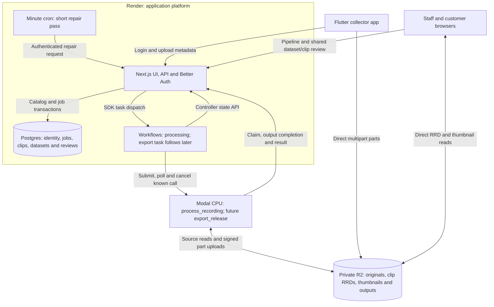

# MVP platform and local parity

Updated: 2026-10-31. Cloud services use the same workflow/task code as the local runner. Solid arrows show control or direct payload transfer as labelled. Video never passes through Next.js.

Local: the official Render Workflows runner starts the same Node tasks; LocalExecutor runs the same Python core, with local Postgres and MinIO. CPU is the default; a separately qualified local GPU profile is optional.
